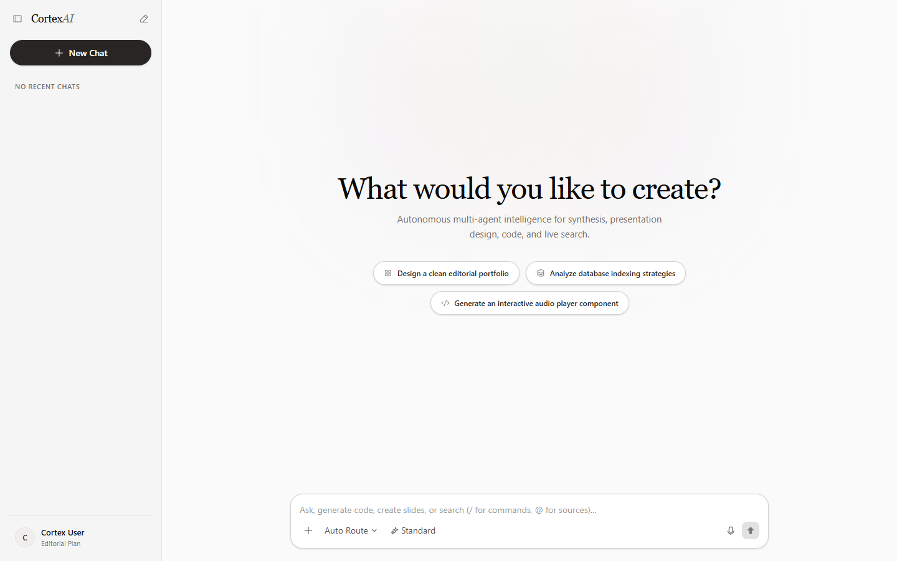

<div align="center">

# CortexAI

**Autonomous Multi-Agent Intelligence Workspace**

*Crafted with Next.js 16 (Turbopack), LangGraph, React Bits, and an ElevenLabs-inspired editorial design system.*

[](https://cortex-ai-111.vercel.app/)
[](https://nextjs.org/)
[](https://langchain-ai.github.io/langgraphjs/)
[](https://tailwindcss.com/)

<br />

<p align="center">
  
</p>

</div>

---

## Overview

**CortexAI** is a unified full-stack AI workspace built on Next.js 16. It combines an autonomous LangGraph multi-agent routing system with editorial UI components, real-time code artifact editors, document compilation, presentation generation, and live web research.

### Key Highlights
- **ElevenLabs-Inspired Design Language**: Quiet editorial clarity featuring warm off-white `#f5f5f5` canvases, `#0c0a09` deep carbon ink, Newsreader serif display typography, and atmospheric lighting.
- **Autonomous Multi-Agent System**: Built on LangGraph state machine routing tasks between specialized models (DeepSeek, Groq Llama, Gemini Flash).
- **Interactive UI Architecture ([React Bits](https://reactbits.dev))**:
  - `PromptBar`: Advanced composer with `@` contextual sources, `/` commands, agent picker, reasoning slider, and voice dictation.
  - `ThoughtLine`: Reasoning trace header with live elapsed timer and animated execution steps.
  - `SwipeRow`: Gesture-based conversation list in the sidebar with full-swipe delete and smooth height collapse.

---

## Multi-Agent Ecosystem

| Agent | Capability | Powered By |
| :--- | :--- | :--- |
| **Auto Route** | Intelligently classifies user intent and delegates to the best agent | LangGraph Router |
| **Code Architect** | Generates full-stack code, modular components, and live interactive Monaco artifacts | DeepSeek / OpenRouter |
| **PDF Publisher** | Compiles research and structured outlines into downloadable editorial PDFs | PDFKit & AWS S3 |
| **Slide Deck (PPT)** | Formulates slide narratives and compiles PowerPoint presentations | PptxGenJS & S3 |
| **Live Web Search** | Real-time internet indexing, citations, and image retrieval | Tavily Search API |
| **Vision & Image** | Visual prompt processing and multimodal concept synthesis | Gemini 2.5 Flash |

---

## Tech Stack

- **Framework**: Next.js 16.4.5 (Turbopack, App Router, Cache Components)
- **State & Store**: Redux Toolkit & React-Redux
- **Multi-Agent Orchestration**: LangGraph JS & LangChain Core
- **AI Models**: Groq (`openai/gpt-oss-120b`), OpenRouter (`deepseek/deepseek-chat`), Google Gemini (`gemini-2.5-flash`)
- **Database & Memory**: MongoDB (Mongoose) with In-Memory Resilient Fallback Repository
- **Storage**: AWS S3 with Presigned Download URLs
- **Authentication**: Firebase Admin SDK & Session Management (with cloud build-safety)
- **UI Components & Motion**: React Bits, Motion (Framer Motion v14), Hugeicons, Tailwind CSS v4

---

## Getting Started

### 1. Clone the repository
```bash
git clone https://github.com/your-username/cortex_ai.git
cd cortex_ai
```

### 2. Install dependencies
```bash
npm install
```

### 3. Environment Variables
Create a `.env.local` file in the root directory:
```env
# MongoDB & Redis
MONGODB_URI=your_mongodb_connection_string
REDIS_URL=redis://localhost:6379

# Firebase Client (Public)
NEXT_PUBLIC_FIREBASE_API_KEY=your_api_key
NEXT_PUBLIC_FIREBASE_AUTH_DOMAIN=your_project.firebaseapp.com
NEXT_PUBLIC_FIREBASE_PROJECT_ID=your_project_id

# AI Providers
GROQ_API_KEY=your_groq_api_key
GOOGLE_API_KEY=your_google_gemini_key
TAVILY_API_KEY=your_tavily_search_key
OPENROUTER_API_KEY=your_openrouter_key

# AWS S3 Storage (for PDF & PPT generation)
AWS_REGION=eu-north-1
AWS_ACCESS_KED_ID=your_aws_key
AWS_SECRET_KED_ID=your_aws_secret
AWS_BUCKET_NAME=your_s3_bucket
```

### 4. Run Development Server
```bash
npm run dev
```
Open [http://localhost:3000](http://localhost:3000) in your browser.

---

## Automated Documentation Screenshot

To automatically capture an updated high-resolution screenshot of the live application and update the README asset:

```bash
npm run screenshot
```
*This command uses Playwright with your system browser to capture `https://cortex-ai-111.vercel.app/` at 1440×900 and saves it to `.github/assets/preview.png`.*

---

## License
MIT © [CortexAI](https://cortex-ai-111.vercel.app/)
